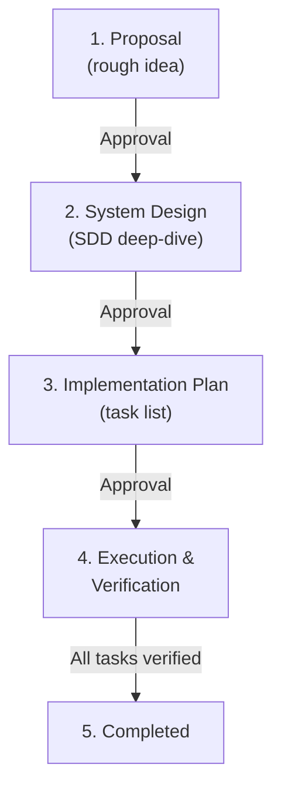

# Spec-Driven Development (SDD)

> "The strength of a family — like the strength of an army — lies in its loyalty to each other."
> Specs are the family pact. Write them before you write code.

SDD is a phased, human-approval-gated workflow. Every non-trivial feature must have a spec before a single line of implementation is written. The spec is the source of truth; the code is its shadow.

---

## Directory Layout

```
spec/
├── README.md          ← index of all specs with status table
├── TEMPLATE.md        ← canonical template (copy for each new spec)
├── AGENTS.md          ← project-specific agent rules (if present, read it)
└── NNN_feature_name/
    └── spec.md        ← the spec document itself
```

- Numbers are zero-padded, sequential (`001`, `002`, …).
- `feature_name` is `snake_case`, concise, descriptive.
- Additional design assets (diagrams, reference data, ADRs) live alongside `spec.md` in the same subdirectory.
- The `spec/README.md` index **must** be updated whenever a spec is added or its status changes.

---

## Phased Workflow



**Each phase transition requires explicit approval from the User.** Never advance to the next phase without it.

---

### Phase 1 — Proposal

**Goal:** Establish *what* and *why*. Scope must be crisp enough to detect gold-plating.

**Status tag:** `PROPOSAL`

**Produce:**
- Problem statement — one paragraph, plain language.
- Proposed solution — approach, not implementation detail.
- In-scope / out-of-scope list — be specific about what is explicitly excluded.

**Exit criteria:** The User reads the proposal and says "go".

**Agent rules:**
- Do **not** design interfaces or data structures yet.
- Do **not** write any code.
- Ask clarifying questions before drafting if requirements are ambiguous.

---

### Phase 2 — System Design (SDD)

**Goal:** Concrete architecture. Enough detail that a second engineer could implement from this document alone.

**Status tag:** `DESIGN`

**Produce:**
- Component breakdown and how changes fit into existing architecture.
- Mermaid diagram(s) where helpful.
- New data structures, interfaces, topics, API contracts.
- Protocol / API changes (wire formats, RPC schemas, CLI flags, config keys).
- Real-time / resource impact analysis (latency, memory, allocations, throughput).

**Exit criteria:** Architectural review signed off by the User.

**Agent rules:**
- Use existing code and documentation as ground truth — read relevant source files before designing.
- Prefer extending existing abstractions over introducing new ones.
- Flag any non-obvious trade-offs or alternatives you considered.
- No code yet.

---

### Phase 3 — Implementation Plan (IP)

**Goal:** Ordered task list with verification steps. A checklist the implementation agent follows mechanically.

**Status tag:** `PLAN`

**Produce:**
- Ordered task breakdown: `[ ] Task N: <title>` with affected files and per-task verification command.
- Risks and mitigation strategy.

**Exit criteria:** Task order and testing strategy approved by the User.

**Agent rules:**
- Each task must be independently verifiable (build, vet, or test after each step).
- Tasks should be small enough to complete and verify in one sitting.
- No code yet.

---

### Phase 4 — Execution & Verification

**Goal:** Implement incrementally. Verify after each task. Log progress in the spec.

**Status tag:** `IMPLEMENTING`

**Agent rules:**
1. Work through tasks **one at a time** in the order defined in Phase 3.
2. After each task, run the verification command specified for that task.
3. Mark the task `[x]` only after verification passes.
4. If verification fails, fix before moving to the next task.
5. After **all** tasks are complete, run the full project verification suite.
6. Request explicit approval from the User before closing the phase.

**Standard verification checklist** (adapt per-project):
- [ ] All per-task verification steps pass.
- [ ] Linter / vet clean on affected packages.
- [ ] Unit tests pass.
- [ ] Integration / build targets compile.
- [ ] Neighbor packages unaffected.
- [ ] Explicit User sign-off.

---

### Phase 5 — Completed

**Goal:** Final review. Close the loop.

**Status tag:** `COMPLETED`

**Criteria:**
- All Phase 4 checklist items are `[x]`.
- No regressions in existing tests.
- Spec document is up to date (Phase 4 log reflects actual changes made).
- `spec/README.md` updated to `COMPLETED`.
- Approved by the User.

---

## Writing Good Specs

### Problem Statements

A strong problem statement answers:
1. What is broken or missing?
2. Who is affected and how?
3. What is the cost of doing nothing?

### Scope Discipline

The out-of-scope list is as important as the in-scope list. Call out adjacent work explicitly, with a forward reference to the spec or backlog item that will address it. This prevents scope creep and clarifies reviewer expectations.

### Diagrams

Use Mermaid where relationships are non-trivial. Prefer `graph TD` for data-flow, `sequenceDiagram` for protocol exchanges, `stateDiagram-v2` for FSMs. Keep diagrams focused — one concern per diagram.

### Real-Time & Resource Constraints

For any code that runs on a hot path (interrupt handler, fixed-rate loop, network fast-path), the spec **must** state:
- Allocation budget (often: zero).
- Latency budget.
- How compliance will be verified (profiler, allocations report, benchmark).

If a constraint cannot be stated, the design is incomplete.

### API / Interface Contracts

Document value ranges, units, and invariants at the interface level. Downstream callers should not need to read implementation source to use an interface correctly. Examples:
- `throttle` in `[0.0, 1.0]` — not `[-1, 2]`.
- Timestamps are Unix nanoseconds (int64), never float seconds.
- Errors are wrapped with `fmt.Errorf("context: %w", err)`.

---

## Status Tags Reference

| Tag | Phase | Meaning |
|-----|-------|---------|
| `PROPOSAL` | 1 | Rough idea, awaiting design approval |
| `DESIGN` | 2 | SDD authored, awaiting architectural review |
| `PLAN` | 3 | Implementation plan ready, awaiting execution approval |
| `IMPLEMENTING` | 4 | Active development |
| `COMPLETED` | 5 | Fully implemented, tested, and approved |

---

## Spec Template

When creating a new spec, copy this template to `spec/NNN_feature_name/spec.md` and fill in every section.

````markdown
# SDD Spec: [Feature Name]

## Metadata
* **Status:** `PROPOSAL`
* **Author:** [Author Name / Agent]
* **Created:** [YYYY-MM-DD]
* **Last Updated:** [YYYY-MM-DD]
* **Approver:** [User Name]

---

## Phase 1: Proposal (Rough Idea)

### 1.1 Problem Statement
*Describe the pain point, gap, or bug. One to three paragraphs.*

### 1.2 Proposed Solution
*Briefly outline the conceptual approach — no implementation detail.*

### 1.3 Scope & Requirements
* **In Scope:**
  * Requirement 1
  * Requirement 2
* **Out of Scope:**
  * Explicitly excluded adjacent work, with references where applicable.

---

## Phase 2: System Design (SDD)

### 2.1 Architecture & Components
*How changes fit into the existing project. Mermaid diagram if helpful.*

```mermaid
graph TD
    %% Diagram goes here
```

### 2.2 Data Structures & Interfaces
*New types, interfaces, topics, schemas, config keys. Value ranges and units.*

### 2.3 Protocol / API Changes
*Wire formats, RPC messages, CLI flags, environment variables, Makefile targets.*

### 2.4 Real-Time & Resource Impacts
*Allocation budget, latency budget, how compliance is verified.*

---

## Phase 3: Implementation Plan (IP)

### 3.1 Task Breakdown
- [ ] **Task 1:** [Title]
  - **Files:** `path/to/file`
  - **Verification:** `<command>`
- [ ] **Task 2:** [Title]
  - **Files:** `path/to/file`
  - **Verification:** `<command>`

### 3.2 Risks & Mitigation
*What could go wrong. How to detect and recover.*

---

## Phase 4: Execution & Verification
- [ ] All per-task verification steps pass.
- [ ] Linter / vet clean.
- [ ] Unit tests pass.
- [ ] Build targets compile.
- [ ] Neighbor packages unaffected.
- [ ] Approved by the User.

---

## Phase 5: Completed
- [ ] All Phase 4 items `[x]`.
- [ ] No regressions.
- [ ] Spec document reflects actual implementation.
- [ ] `spec/README.md` updated to `COMPLETED`.
- [ ] Approved by the User.
````

---

## README Index Template

Maintain `spec/README.md` as the single authoritative index. Keep status emoji consistent:

| Emoji | Status |
|-------|--------|
| 📝 | `PROPOSAL` |
| 🔷 | `DESIGN` |
| 📋 | `PLAN` |
| 🚧 | `IMPLEMENTING` |
| ✅ | `COMPLETED` |

```markdown
# Specifications Index

> SDD specs for [Project Name].
> See [TEMPLATE.md](TEMPLATE.md) for the template and [AGENTS.md](AGENTS.md) for workflow rules.

## Completed

| # | Feature | Status | Created | Updated | Spec |
| :--- | :--- | :--- | :--- | :--- | :--- |
| 001 | Example Feature | ✅ COMPLETED | YYYY-MM-DD | YYYY-MM-DD | [spec.md](001_example_feature/spec.md) |

## In Progress

| # | Feature | Status | Created | Updated | Spec |
| :--- | :--- | :--- | :--- | :--- | :--- |

## Proposed

| # | Feature | Status | Created | Updated | Spec |
| :--- | :--- | :--- | :--- | :--- | :--- |
```

---

## Agent Checklist Before Writing Any Code

Before touching a source file, verify:

1. **Spec exists** — there is a `spec.md` for this feature.
2. **Phase is ≥ PLAN** — design is complete and approved; `PROPOSAL` or `DESIGN` status means *design only, no code*.
3. **Current task is identified** — you know which unchecked task from Phase 3 you are executing.
4. **Verification command is known** — you will run it after completing the task.
5. **No scope creep** — changes are limited to what the spec says. Discovered out-of-scope work goes into a new spec or the backlog.

> "Leave the gun. Take the cannoli." — Finish the task in the spec. Resist the urge to fix unrelated things.
